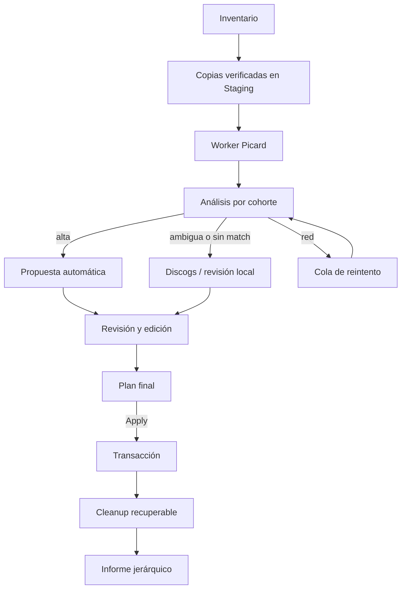

# Arquitectura

## Componentes actuales

| Archivo | Responsabilidad actual |
|---|---|
| `music_library.py` | punto de entrada |
| `musiclib/ui.py` | pantallas, color y entrada de teclado |
| `musiclib/storage.py` | rutas, bloqueo, catálogo, escritura atómica y Recovery |
| `musiclib/metadata.py` | lectura/escritura de etiquetas, identidades y nombres |
| `musiclib/picard.py` | perfil temporal, comandos y validación de Picard |
| `musiclib/engine.py` | inventario, planificación, deduplicación, promoción y commit |
| `musiclib/playlists.py` | creación y reparación de M3U |

El prototipo ya separa razonablemente almacenamiento, metadatos, Picard, playlists y UI. La refactorización debe conservar esa separación y añadir estados de dominio explícitos, sin volver a un script monolítico.

## Flujo objetivo

## Modelo de dominio que falta

La siguiente implementación debe introducir objetos o estructuras equivalentes:

- `ImportSession`: inventario, estado de red, propuestas, decisiones y plan final.
- `Cohort`: conjunto recibido que se evalúa como posible release o playlist.
- `ReleaseProposal`: metadatos, fuente, confianza, edición, discos, pistas presentes y ausentes.
- `TrackProposal`: archivo, identidades, posición, metadatos propuestos y overrides.
- `PendingItem`: unidad completa o pista con motivo, contexto y referencias de playlist.
- `PlaylistProposal`: orden, repeticiones, resueltas, reutilizadas, nuevas y pendientes.
- `OperationPlan`: todas las mutaciones y limpiezas que se confirmarán juntas.

Los estados deben ser datos estructurados (`network_error`, `no_match`, `partial_match`, `fatal_error`), no conclusiones deducidas de texto de logs.

## Worker de Picard

El objetivo es una sola instancia auxiliar por sesión de importación:

1. crear un perfil temporal aislado y sin avisos;
2. iniciar Picard en segundo plano de la forma más discreta que permita macOS;
3. cargar una cohorte, ejecutar Lookup y después Scan agrupado si hace falta;
4. esperar barreras de red y escritura;
5. validar etiquetas y MBIDs en disco;
6. `REMOVE_ALL` antes de la siguiente cohorte;
7. cerrar o matar una sola vez al final.

No hay que asumir que Picard ofrece un modo headless real. Debe hacerse una prueba técnica específica para el lanzamiento oculto y documentar la limitación si macOS todavía muestra una ventana. La secuencia de comandos, los timeouts y la detección del servicio deben aislarse tras una interfaz para poder adaptar una futura compilación Apple Silicon.

## Identidad y procedencia

Orden de identidad fuerte:

1. Recording MBID para la grabación.
2. Release/Release Group MBID más disco y posición para una aparición concreta.
3. Discogs release ID más disco y posición cuando se confirma esa fuente.
4. Identidad local persistente para material sin catálogo externo.
5. Hash de contenido para comprobar copias y conflictos.

La procedencia (`musicbrainz`, `discogs`, `local`, `user_override`) se almacena por campo o propuesta. Nunca se crea un MBID local falso.

## Catálogo

El catálogo debe evolucionar con migración versionada. Además de archivos y alias, necesita:

- releases y ediciones;
- discos esperados y presentes;
- pistas o posiciones ausentes;
- identidades locales;
- fuente y confianza de metadatos;
- overrides del usuario;
- playlists, orden y repeticiones;
- referencias a Pending;
- historial mínimo para reconstruir rutas.

No se debe reutilizar un catálogo viejo sin migración explícita y copia de seguridad.

## Transacciones

El patrón existente de preparar, aplicar y recuperar por SHA-256 es válido. El plan objetivo agrupa:

- escritura o sustitución de audio;
- consumo de Incoming;
- movimiento de sidecars;
- cambios del catálogo;
- escrituras M3U;
- limpieza conocida de Finder;
- poda de directorios vacíos.

Cada escritura sustituible usa un archivo temporal en el mismo volumen y rename atómico. Recovery registra before/after y no pisa cambios externos. `Apply` es el único punto que inicia mutaciones.

## Integración Discogs

Debe ser un adaptador independiente del motor. El motor entrega una cohorte normalizada; el adaptador devuelve candidatos y tracklists. La puntuación compara secuencias completas y expone evidencias a la UI. Un límite de API o un error de autenticación se trata como servicio no disponible, nunca como `no_match`.

La autenticación sigue abierta. El diseño debe impedir que el token termine en Git, logs, mensajes de error o copias compartidas del SSD.

